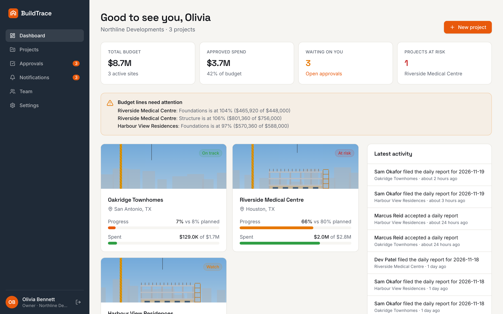
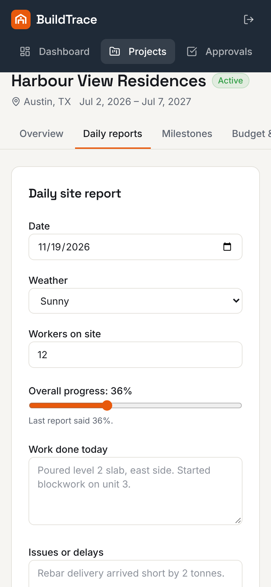

# BuildTrace

**Remote construction monitoring for property developers and investors.**

BuildTrace lets the people paying for a building see how it's really going without being on site. Supervisors file daily reports with geotagged photos, contractors submit evidence for milestones, managers inspect and approve, and owners sign off before money moves. Every invoice is tracked against a budget line, so overruns show up while they're still small.


## Why

85% of construction projects go over budget, by 28% on average ([source](https://www.propelleraero.com/blog/10-construction-project-cost-overrun-statistics-you-need-to-hear/)). Owners usually find out from a monthly report, long after the money is spent. BuildTrace shortens that loop to one day.

## Try the demo

Run it locally (below), then pick a role on the landing page. The seeded company, **Northline Developments**, has three projects in different states: one on track, one at risk and over budget on two lines, and one just starting. Approvals are already waiting for each role.

| Role | Person | What to try |
| --- | --- | --- |
| Owner | Olivia | Sign off a milestone, approve an invoice over the $10,000 limit |
| Project manager | Marcus | Review today's report, inspect submitted work, approve invoices |
| Site supervisor | Sam | File a daily report from a phone with photos |
| Contractor | Carla | Mark a milestone done with photo evidence, submit an invoice |

All demo accounts use the password `buildtrace-demo`.

## Features

- **Daily site reports:** weather, crew size, work done, issues and photos tagged with GPS location. Mobile-first, with the camera opening directly. Managers accept or send back with a note, and a daily job alerts managers when a site hasn't reported by 6 PM.
- **Milestone verification:** a three-step sign-off (contractor submits evidence, manager inspects, owner signs off) tied to a payment amount. Rejections need a reason and can be resubmitted.
- **Budget against actual:** invoices are approved against budget lines. Lines turn amber at 90% and red past 100%. Invoices over the company's limit need the owner as well as the manager. Crossing a threshold sends an alert.
- **Forecast final cost:** approved spend divided by site-reported progress, compared with a straight-line schedule to flag projects that are behind.
- **Dashboard:** portfolio totals, projects at risk, budget warnings, a progress chart against plan, approved spend over time and budget by line.
- **Photo timeline:** every report and milestone photo, grouped by day.
- **Audit trail:** every approval, rejection and budget change is recorded with who did it and when.
- **Notifications:** in-app and by email (through Resend) for every step that needs someone.
- **Accounts:** sign-up creates a company, owners invite people by role, and users can reset their password by email.

| | |
| --- | --- |
|  |  |
|  |  |

<p align="center"></p>

## Roles and permissions

| | Admin | Owner | Manager | Supervisor | Contractor |
| --- | :-: | :-: | :-: | :-: | :-: |
| See all company projects | ✓ | ✓ | | | |
| Create projects, edit budget and milestones | ✓ | ✓ | ✓ | | |
| File daily reports | | | ✓ | ✓ | |
| Review daily reports | ✓ | | ✓ | | |
| Submit milestone evidence | | | ✓ | | ✓ |
| Inspect milestones | | | ✓ | | |
| Sign off milestones | | ✓ | | | |
| Submit invoices | | | ✓ | ✓ | ✓ |
| Approve invoices | | over limit | ✓ | | |
| Invite people, company settings | ✓ | ✓ | | | |

The rules live in [`src/lib/permissions.ts`](src/lib/permissions.ts). The approval state machines live in [`src/lib/workflow.ts`](src/lib/workflow.ts). Both are checked on the server for every action, not just hidden in the UI.

## Tech stack

| Layer | Choice |
| --- | --- |
| App | Next.js 16 (App Router, Server Actions), React 19, TypeScript |
| UI | Tailwind CSS 4, Lucide icons, Recharts |
| Data | PostgreSQL with Prisma |
| Auth | Email and password (bcrypt), signed JWT session cookie (jose), role-based access |
| Files | Vercel Blob in production, local disk in development |
| Email | Resend (logged to the console when no key is set) |
| Tests | Vitest for business logic, Playwright for end-to-end workflows |
| CI | GitHub Actions: lint, type check, unit tests, build, end-to-end tests against Postgres |

## Project structure

```
prisma/
  schema.prisma        10 tables: companies, users, projects, budget lines, milestones, reports, photos, expenses, notifications, audit events
  seed.ts              demo company with dates relative to today
src/
  app/
    (auth)/            login, sign-up, password reset, invites
    (app)/             dashboard, projects, approvals, notifications, team, settings
    actions/           server actions for every workflow
    api/cron/          daily missing-report alert
  components/          UI kit, charts, forms
  lib/
    budget.ts          budget, forecast and schedule maths (pure, unit tested)
    workflow.ts        milestone and invoice state machines (pure, unit tested)
    permissions.ts     role rules
tests/
  unit/                Vitest
  e2e/                 Playwright: report, milestone, invoice, roles, sign-up flows
```

## Running locally

You need Node 22 and a PostgreSQL database.

```bash
npm install
cp .env.example .env          # set DATABASE_URL and AUTH_SECRET
npx prisma migrate deploy
npm run db:seed               # optional: demo company
npm run dev
```

Open http://localhost:3000.

### Tests

```bash
npm test                      # unit tests
npm run build && npx playwright install chromium && npm run test:e2e
```

The end-to-end suite reseeds the demo company before it runs.

## Deploying

1. Create a Postgres database (for example on [Neon](https://neon.tech)) and copy its connection string.
2. Import this repo into [Vercel](https://vercel.com/new).
3. Set these environment variables: `DATABASE_URL`, `AUTH_SECRET` (32+ random characters) and `APP_URL` (your site's URL). Optionally set `RESEND_API_KEY` and `EMAIL_FROM` for real emails, and `CRON_SECRET` for the daily alert.
4. Add a Vercel Blob store to the project for photo uploads. Vercel sets `BLOB_READ_WRITE_TOKEN` for you.
5. Run `npx prisma migrate deploy` and `npm run db:seed` against the production database.

`vercel.json` schedules the missing-report check for 6 PM, Monday to Saturday.

## Roadmap

- Weekly PDF report for owners
- Material procurement and delivery tracking
- Offline drafts for sites with poor signal
- Reading invoice amounts from uploaded PDFs

## License

MIT
