<p align="center"></p>

# Trussly

**Plan • Build • Manage.** Remote construction monitoring for property developers and investors.

**Live demo: [gettrussly.vercel.app](https://gettrussly.vercel.app)**. Tap any role to look around, no sign-up needed.

Trussly lets the people paying for a building see how it's really going without being on site. Supervisors file daily reports with geotagged photos, contractors submit evidence for milestones, managers inspect and approve, and owners sign off before money moves. Every invoice is tracked against a budget line, so overruns show up while they're still small.

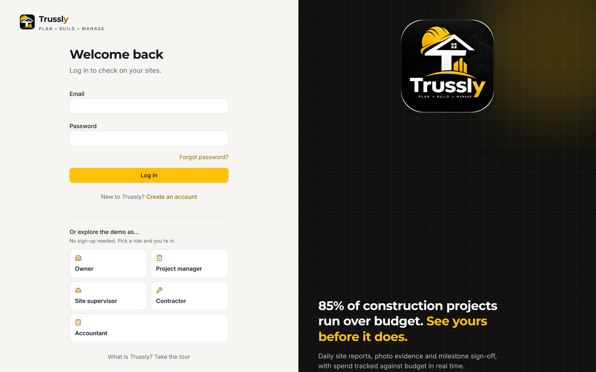

## Why

85% of construction projects go over budget, by 28% on average ([source](https://www.propelleraero.com/blog/10-construction-project-cost-overrun-statistics-you-need-to-hear/)). Owners usually find out from a monthly report, long after the money is spent. Trussly shortens that loop to one day.

## Try the demo

Open the [live demo](https://gettrussly.vercel.app) or run it locally (below), then pick a role on the front page. No sign-up is needed: the role tiles log you straight in. The product tour lives at `/about`. The seeded company, **Northline Developments**, has four projects in different states: one on track, one at risk and over budget on two lines, one just starting, and one handed over with retention waiting to be released. Approvals are already waiting for each role.

| Role | Person | What to try |
| --- | --- | --- |
| Owner | Olivia | Give final approval on $180,000 of work, approve and sign the $64,000 solar change order, sign the electrical subcontract, release retention on Cedar Park, approve a purchase order, settle the escalated crane dispute, open Analytics |
| Project manager | Marcus | Approve inspected electrical work, decide the RFI-14 change order, raise a purchase order, reply to Carla in Messages |
| Site supervisor | Sam | Inspect the level 2 slab, file a daily report from a phone, receive a cable delivery and log material use |
| Contractor | Carla | Submit work with photos, invoice for verified work, propose a change order, raise a dispute, chat with the team |
| Accountant | Fiona | Pay an overdue invoice, record a partial payment, see an invoice on hold because of a dispute |

All demo accounts use the password `trussly-demo`.

## How the money works

Trussly keeps **work** and **payment** on two separate tracks, because "the work is done", "the work is verified", "the invoice is approved" and "the contractor is paid" are four different facts.

```
Work:     Not started → In progress → Awaiting inspection → Awaiting manager → (Awaiting owner) → Approved · verified
                                ↖────────── Requires corrections ──────────┘
Payment:  No invoice → Invoice submitted → (Under review) → Awaiting payment → Payment processing → Partially paid → Fully paid
```

- An invoice tied to work **can't be approved until that work is verified**.
- Work and invoices over the company's limit ($10,000 in the demo) need the owner as well as the manager.
- 5% **retention** is held on work invoices until handover, then released by the owner or manager and paid by the accountant.
- "No invoice", "Partially paid", "Overdue" and "Completed" are worked out from the data (invoices, payments, due dates), so they can never drift out of sync.

## Features

- **Work verification:** the contractor submits completed work with photos, the site supervisor inspects and passes it or asks for corrections, the project manager approves, and the owner gives final approval above the limit. Every step is recorded.
- **Invoices and payments:** contractors invoice against budget lines and verified work. Managers and owners approve, and the accountant records full or partial payments with references, or refuses a payment with a reason. Due dates follow the company's payment terms.
- **Finance:** what's approved and unpaid, what's overdue, what was paid this month, retention held, payment history and a budget, committed and paid report for each project.
- **Daily site reports:** weather, workforce, work done, challenges, materials received, equipment used, site incidents, supervisor remarks, and photos and videos tagged with GPS location. Mobile-first.
- **Dashboards for each role:** owners see the portfolio, budget warnings and approvals. Supervisors see inspections and today's reports. Contractors see their work, invoices and what they're owed. Accountants see payments due and overdue.
- **Budget against actual:** lines turn amber at 90% and red past 100%, and crossing a threshold sends an alert.
- **Change orders:** anyone on the commercial side proposes a priced change with a reason and schedule impact. The manager approves up to the limit and the owner above it, by typing their name as a signature. Approval moves the budget line, the work value and the end date, and the original budget is always shown next to the revised one.
- **Purchase orders and materials:** orders over the limit wait for the owner. The supervisor logs deliveries against each order, and stock on site is delivered minus used, with a low-stock alert at each material's reorder level.
- **Expense forecasting:** each budget line's known cost is approved invoices plus invoices in review plus orders not yet invoiced. The forecast is the revised budget, or the known cost where that is higher, so real overruns show up before the invoices arrive.
- **Documents and digital signatures:** drawings, contracts, permits and reports by category, with versions kept when the same title is uploaded again. Documents can require signatures from named people on the project, and only they can sign. Each signature records the typed name, role, time and a SHA-256 fingerprint of the file, version and signer.
- **Retention release at handover:** 5% is held back on work invoices. Once the project is marked completed, the owner or manager releases it in one step, contractors are told, and the accountant pays it like any other balance.
- **Contractor ratings:** verified work is rated 1 to 5 for quality, timeliness and safety. Scorecards show on the Team page and in Analytics, next to how much work was verified on time.
- **Disputes:** raised on work, an invoice or in general, with a message thread. The manager resolves them, or they're escalated to the owner. A disputed invoice can't be paid until the dispute is resolved.
- **Messages:** direct chats, named group chats with anyone in the company, a company-wide chat and a thread for every project. Unread counts show in the nav, and direct and group messages also notify by email.
- **Analytics across projects:** spend by month (approved against paid), cost variance per project, change orders, open disputes, the average days from approval to payment and a contractor scorecard.
- **Notifications:** in-app and by email (through Gmail or any SMTP account, or Resend) for work submitted, inspection requests, approvals, corrections, new invoices, invoice approvals, payments, budget alerts, deadlines coming up and overdue work and invoices.
- **Photo timeline and audit trail:** every photo by day, and every approval, rejection, signature, payment and budget change with who did it and when. The audit trail filters by type, person, date and text, and exports to CSV.
- **Accounts:** sign-up creates a company, owners invite people by role, and users can reset their password by email.
- **Two people before money moves:** invoices, retention release, change orders and purchase orders need the owner plus a manager or the accountant. Each ticks what the money is for, nobody can confirm their own request, and both names go in the audit trail. The owner sets the amount from which two people are needed, and can let chosen roles sign in their place until a date, recorded as "for the owner".
- **Photos and videos as evidence:** on work submissions, daily reports, disputes and chats. Files upload straight from the phone to Vercel Blob at full quality (photos up to 50 MB, videos up to 500 MB) and videos play in place.
- **Simple screens and a tutorial:** short labels, forms tucked behind a + until needed, and a ☰ menu on phones. A short first-run tutorial for each role can be skipped and reopened from the menu.

| | |
| --- | --- |
|  | 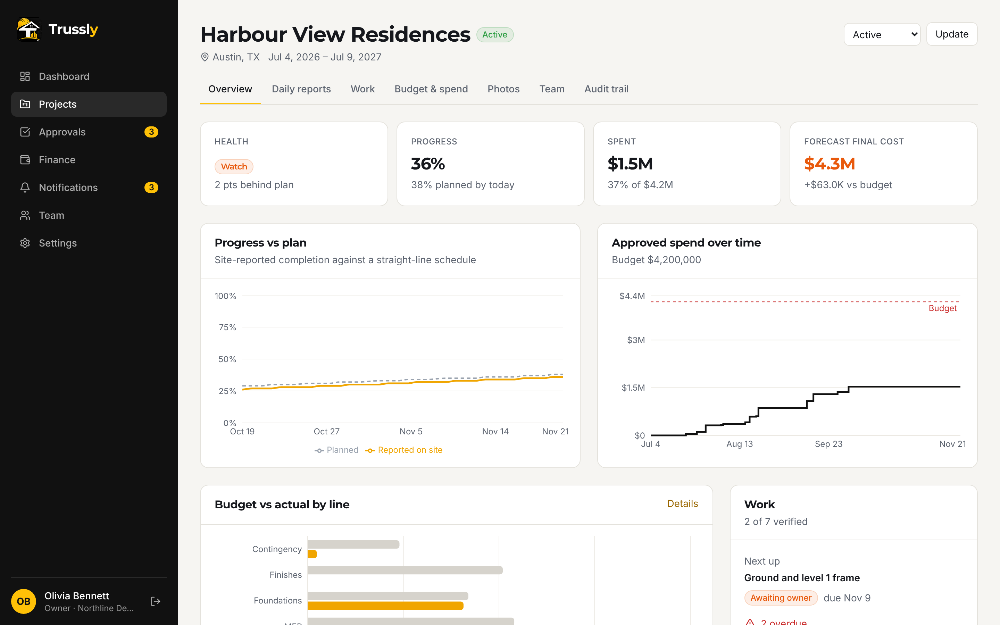 |
| 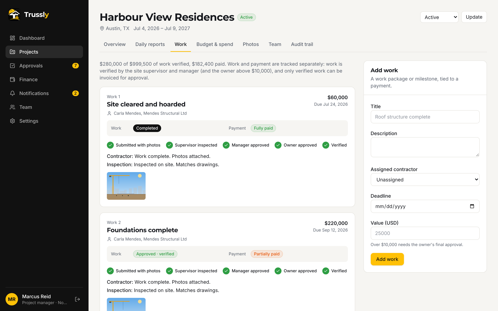 |  |
|  |  |
| 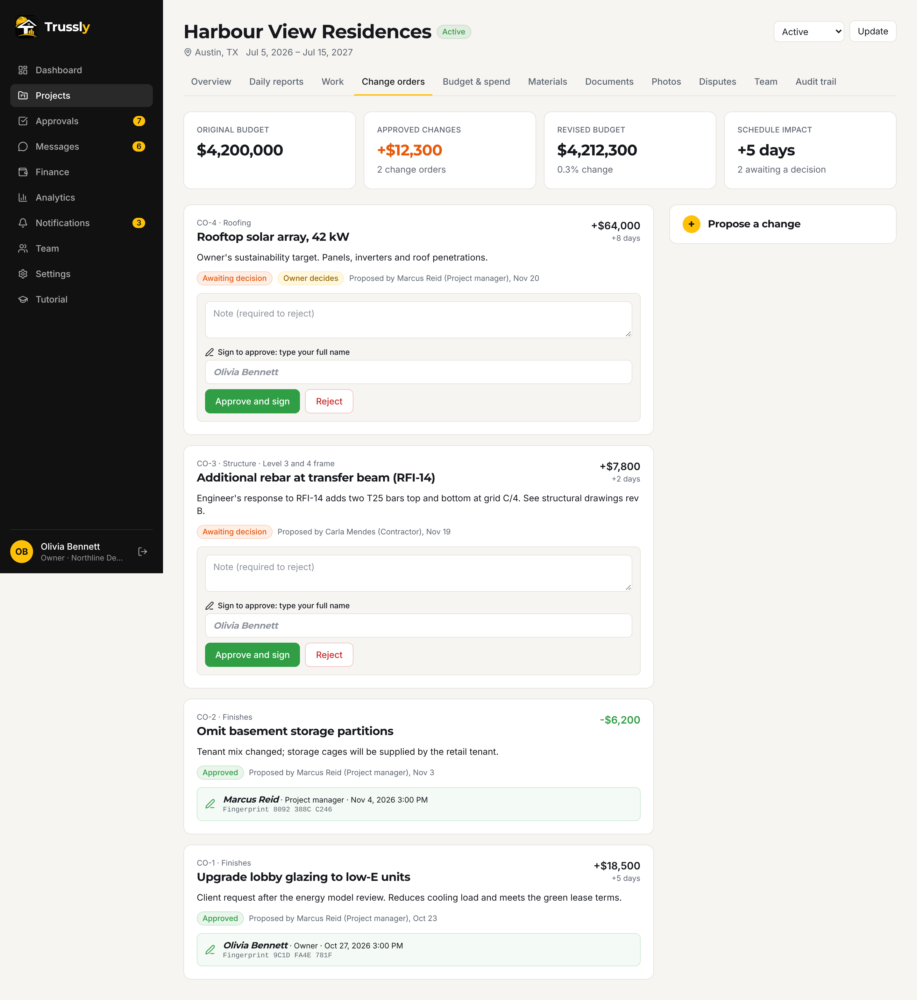 | 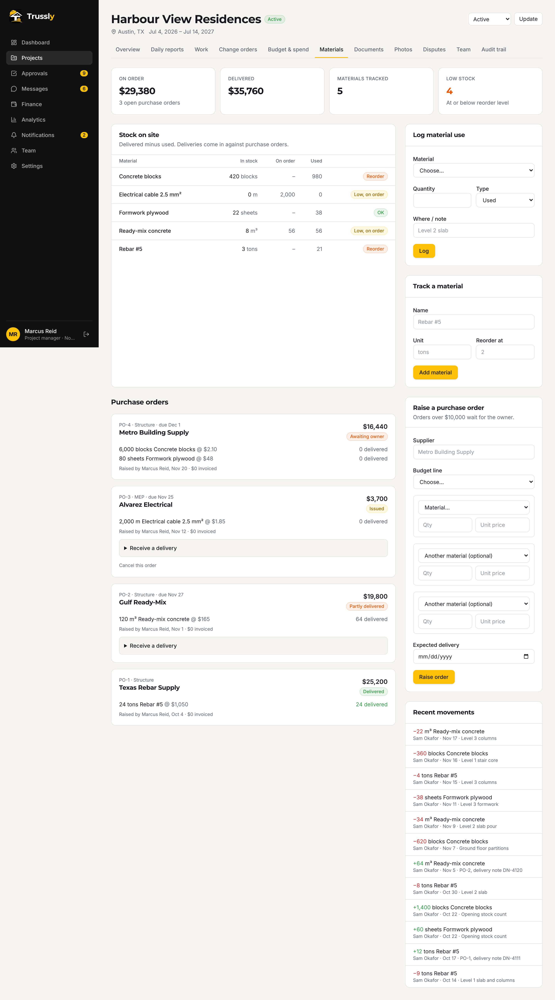 |
| 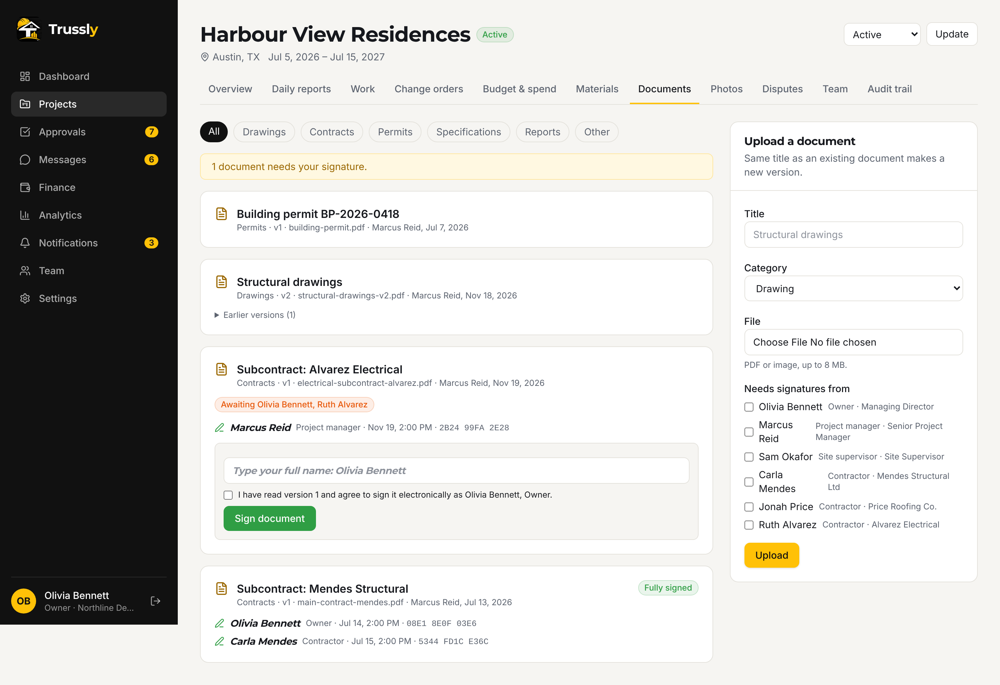 | 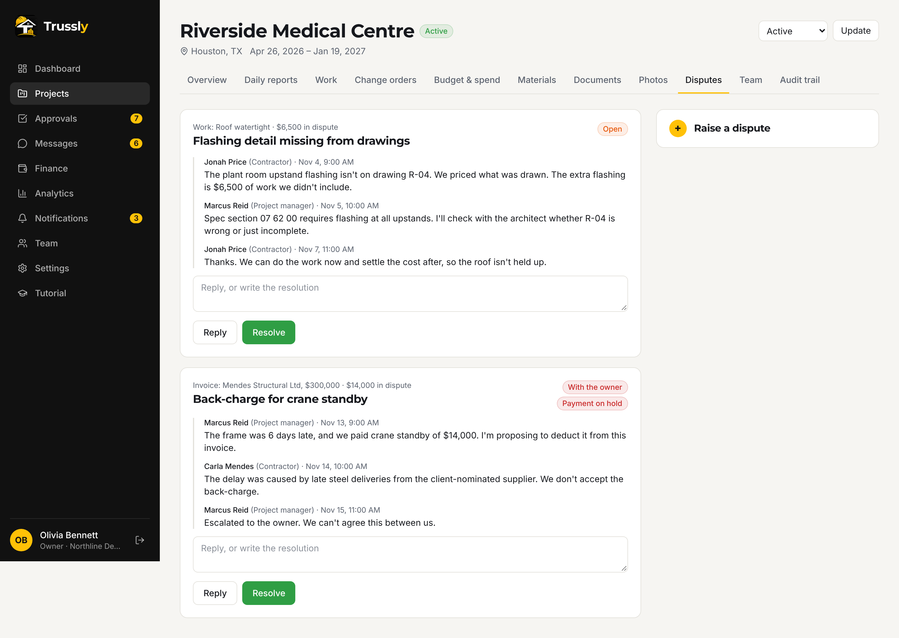 |
| 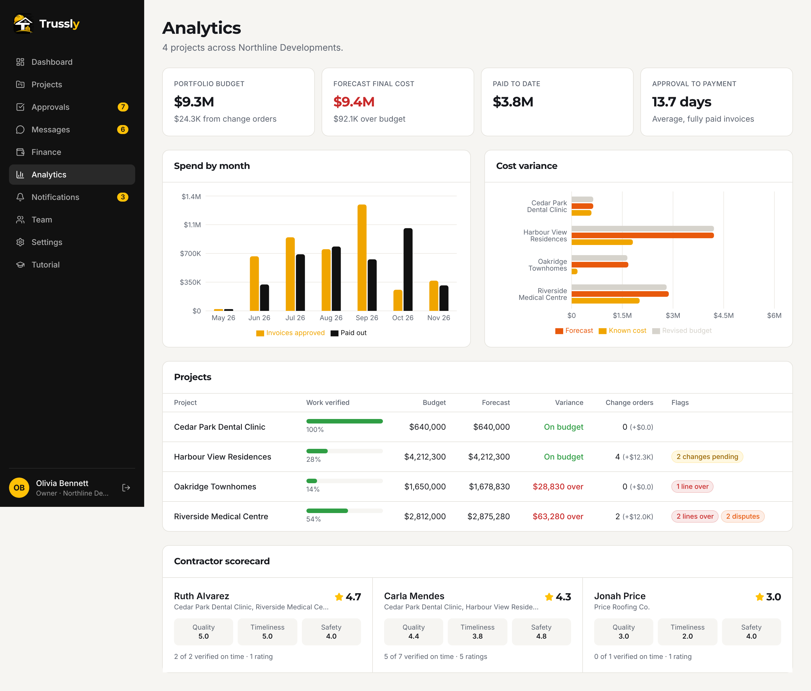 | 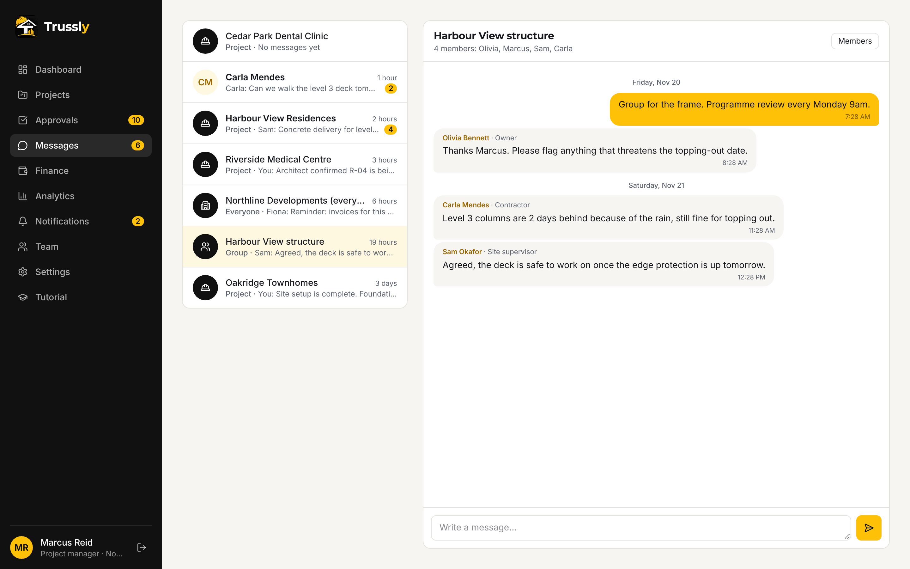 |
| 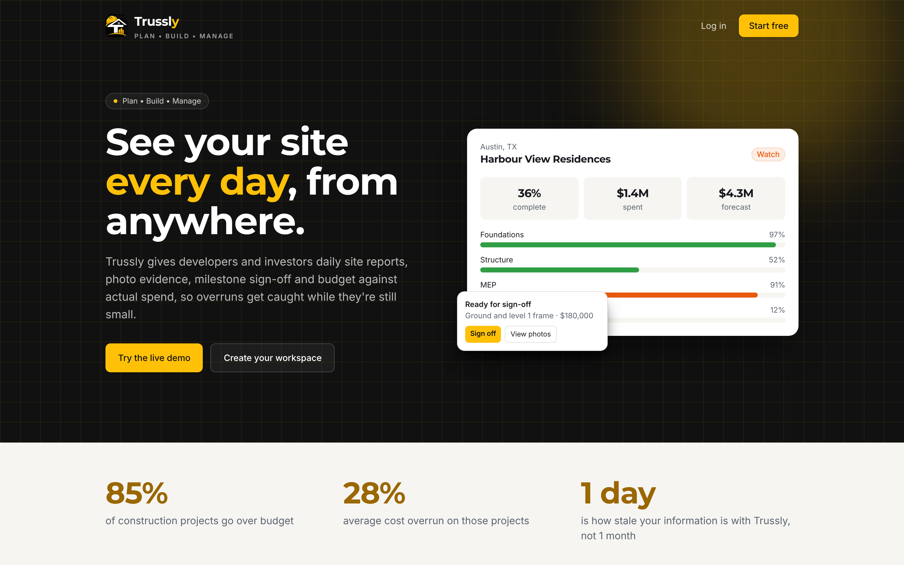 | 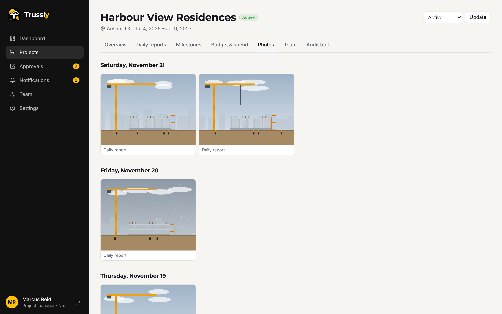 |

<p align="center"> 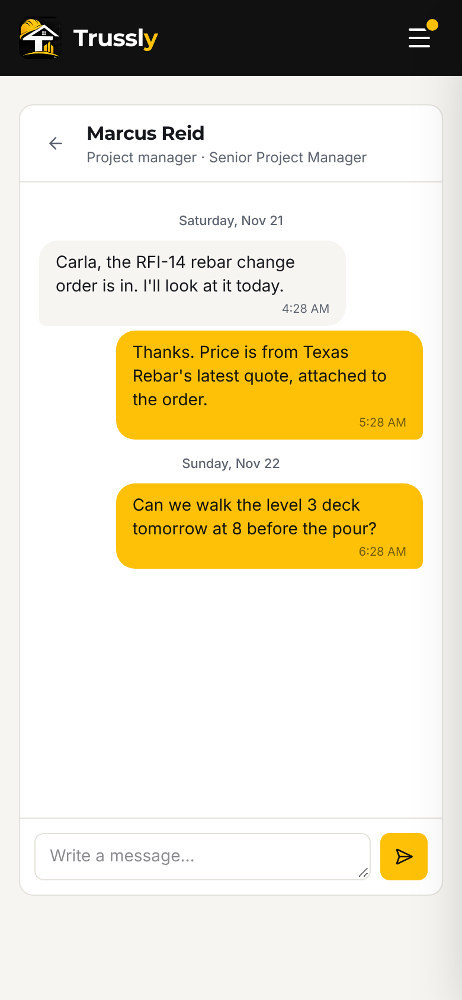 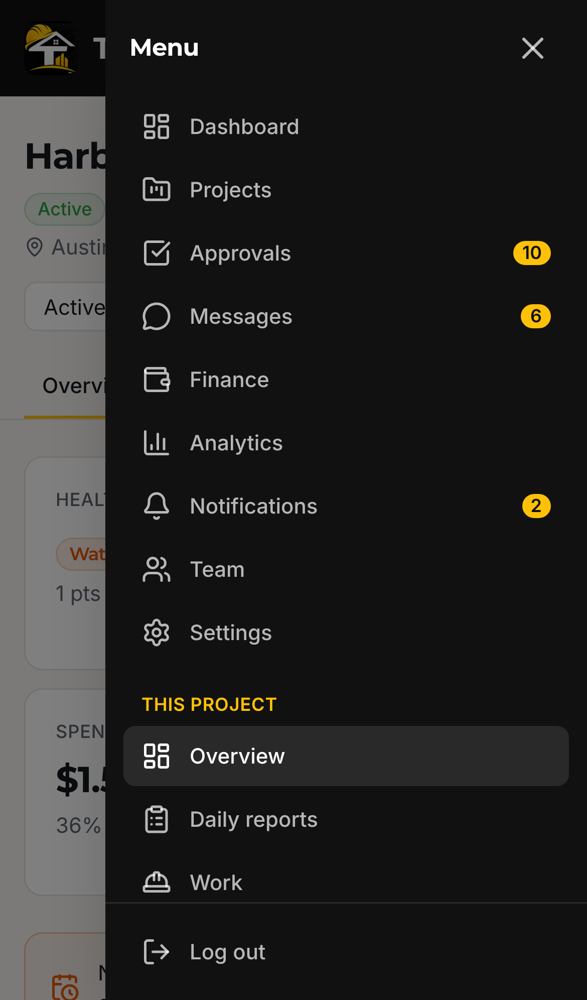</p>

<p align="center">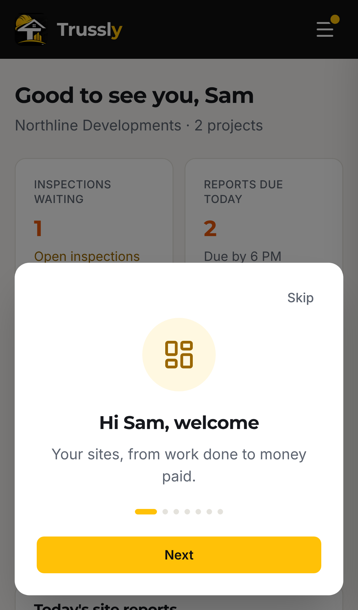</p>

## Roles and permissions

| | Admin | Owner | Manager | Supervisor | Contractor | Accountant |
| --- | :-: | :-: | :-: | :-: | :-: | :-: |
| See all company projects | ✓ | ✓ | | | | ✓ |
| Create projects, assign people, add work and budgets | ✓ | ✓ | ✓ | | | |
| File daily reports | | | ✓ | ✓ | | |
| Review daily reports | ✓ | | ✓ | | | |
| Submit work with photos | | | ✓ | | ✓ | |
| Inspect work | | | ✓ | ✓ | | |
| Approve inspected work | | | ✓ | | | |
| Final approval on work | | over limit | | | | |
| Submit invoices | | | ✓ | ✓ | ✓ | |
| Approve invoices | | over limit | ✓ | | | |
| Record and refuse payments | ✓ | | | | | ✓ |
| Propose change orders | | ✓ | ✓ | | ✓ | |
| Approve change orders and purchase orders | | over limit | ✓ | | | |
| Receive deliveries, log material use | | | ✓ | ✓ | | |
| Rate contractors | | ✓ | ✓ | ✓ | | |
| Resolve disputes | ✓ | ✓ | ✓ (until escalated) | | | |
| Analytics | ✓ | ✓ | ✓ | | | ✓ |
| Finance page | ✓ | ✓ | ✓ | | | ✓ |
| Invite people, company settings | ✓ | ✓ | | | | |

The rules live in [`src/lib/permissions.ts`](src/lib/permissions.ts). The work and payment state machines live in [`src/lib/workflow.ts`](src/lib/workflow.ts), and the worked-out statuses in [`src/lib/status.ts`](src/lib/status.ts). Both are checked on the server for every action, not just hidden in the UI.

## Tech stack

| Layer | Choice |
| --- | --- |
| App | Next.js 16 (App Router, Server Actions), React 19, TypeScript |
| UI | Tailwind CSS 4, Lucide icons, Recharts |
| Data | PostgreSQL with Prisma |
| Auth | Email and password (bcrypt), signed JWT session cookie (jose), role-based access |
| Files | Vercel Blob in production, local disk in development |
| Email | SMTP such as Gmail, or Resend (logged to the console when neither is set) |
| Tests | Vitest for business logic, Playwright for end-to-end workflows |
| CI | GitHub Actions: lint, type check, unit tests, build, end-to-end tests against Postgres |

## Project structure

```
prisma/
  schema.prisma        companies, users, projects, budget lines, work, reports, photos, invoices, payments, change orders,
                       purchase orders, materials, documents, signatures, ratings, disputes, chats, notifications, audit events
  seed.ts              demo company with dates relative to today
src/
  app/
    (auth)/            login, sign-up, password reset, invites
    (app)/             dashboard, projects, approvals, messages, analytics, finance, notifications, team, settings
    actions/           server actions for every workflow
    api/cron/          daily missing-report alert
  components/          UI kit, charts, forms
  lib/
    budget.ts          budget, forecast and schedule maths (pure, unit tested)
    workflow.ts        work and invoice state machines (pure, unit tested)
    status.ts          payment and work statuses worked out from the data
    commercial.ts      change orders, purchase orders, stock, forecasting, ratings, disputes, signatures (pure, unit tested)
    messages.ts        chats, membership and unread counts
    permissions.ts     role rules
tests/
  unit/                Vitest
  e2e/                 Playwright: reports, work verification, invoices, payments, change orders, deliveries,
                       signatures, disputes, messages, analytics, roles, sign-up
```

## Running locally

You need Node 22 and a PostgreSQL database.

```bash
npm install
cp .env.example .env          # set DATABASE_URL and AUTH_SECRET
npx prisma migrate deploy
npm run db:seed               # optional: demo company
npm run dev
```

Open http://localhost:3000.

### Tests

```bash
npm test                      # unit tests
npm run build && npx playwright install chromium && npm run test:e2e
```

The end-to-end suite reseeds the demo company before it runs.

## Deploying

1. Create a Postgres database on [Neon](https://neon.tech) and copy its connection string with connection pooling turned off.
2. Import this repo into [Vercel](https://vercel.com/new) and set `DATABASE_URL`, `AUTH_SECRET` (40+ random characters) and `APP_URL` (your site's URL). For real emails, set `SMTP_USER` and `SMTP_PASS` (a Gmail address and a Google app password work without a domain), or `RESEND_API_KEY` and `EMAIL_FROM` with a domain verified in Resend. If email fails, the Team page shows each invite link to copy. Optionally set `CRON_SECRET` for the daily alert.
3. In the Vercel project, go to **Storage**, create a **Blob** store and connect it. This sets `BLOB_READ_WRITE_TOKEN` for photo uploads.
4. Deploy. The `vercel-build` script runs the database migrations and creates the demo company the first time, so no terminal is needed.

`vercel.json` schedules the daily checks for 6 PM, Monday to Saturday: missing site reports, upcoming and overdue work, and overdue invoices.

## Roadmap

- Real-time chat over websockets (messages refresh every few seconds today)
- Weekly PDF report for owners
- Offline drafts for sites with poor signal
- Reading invoice amounts from uploaded PDFs

## License

MIT
