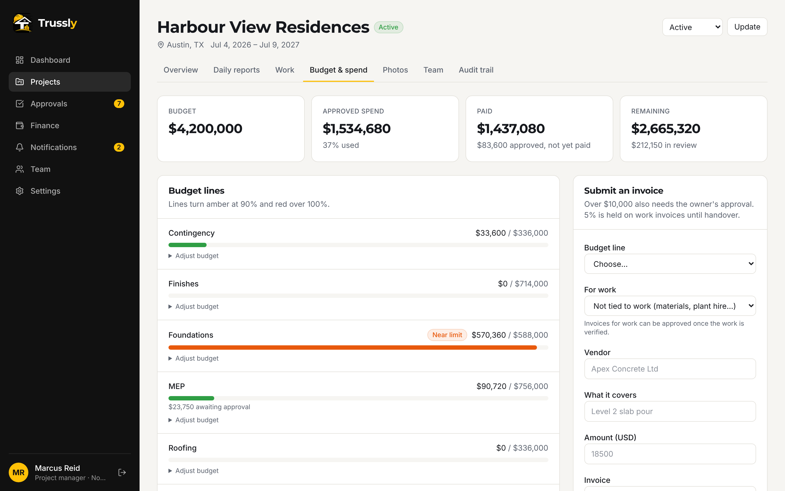
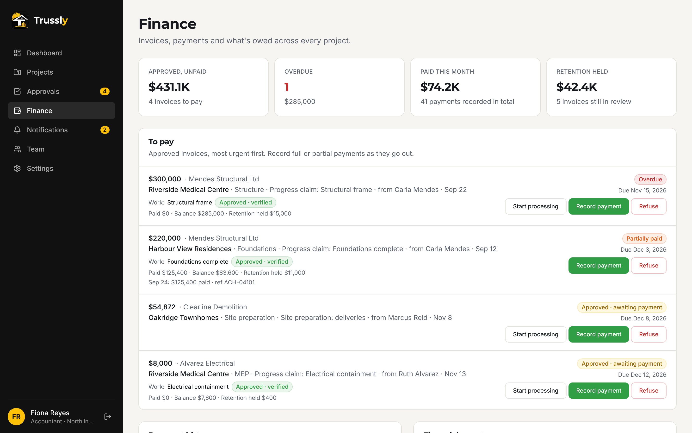
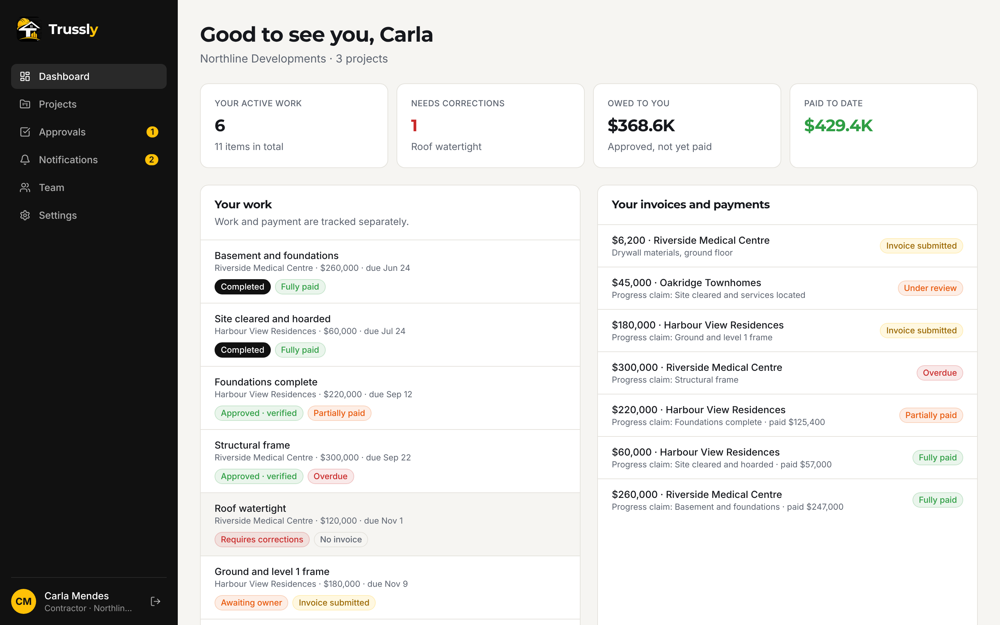

<p align="center"></p>

# Trussly

**Plan • Build • Manage.** Remote construction monitoring for property developers and investors.

**Live demo: [gettrussly.vercel.app](https://gettrussly.vercel.app)**. Tap any role to look around, no sign-up needed.

Trussly lets the people paying for a building see how it's really going without being on site. Supervisors file daily reports with geotagged photos, contractors submit evidence for milestones, managers inspect and approve, and owners sign off before money moves. Every invoice is tracked against a budget line, so overruns show up while they're still small.


## Why

85% of construction projects go over budget, by 28% on average ([source](https://www.propelleraero.com/blog/10-construction-project-cost-overrun-statistics-you-need-to-hear/)). Owners usually find out from a monthly report, long after the money is spent. Trussly shortens that loop to one day.

## Try the demo

Open the [live demo](https://gettrussly.vercel.app) or run it locally (below), then pick a role on the front page. No sign-up is needed: the role tiles log you straight in. The product tour lives at `/about`. The seeded company, **Northline Developments**, has three projects in different states: one on track, one at risk and over budget on two lines, and one just starting. Approvals are already waiting for each role.

| Role | Person | What to try |
| --- | --- | --- |
| Owner | Olivia | Give final approval on $180,000 of work, approve an invoice over the $10,000 limit |
| Project manager | Marcus | Approve inspected electrical work, review today's report, approve invoices |
| Site supervisor | Sam | Inspect the level 2 slab, file a daily report from a phone with photos |
| Contractor | Carla | Fix and resubmit the roof work, submit work with photos, invoice for verified work |
| Accountant | Fiona | Pay an overdue invoice, record a partial payment, check the financial report |

All demo accounts use the password `trussly-demo`.

## How the money works

Trussly keeps **work** and **payment** on two separate tracks, because "the work is done", "the work is verified", "the invoice is approved" and "the contractor is paid" are four different facts.

```
Work:     Not started → In progress → Awaiting inspection → Awaiting manager → (Awaiting owner) → Approved · verified
                                ↖────────── Requires corrections ──────────┘
Payment:  No invoice → Invoice submitted → (Under review) → Awaiting payment → Payment processing → Partially paid → Fully paid
```

- An invoice tied to work **can't be approved until that work is verified**.
- Work and invoices over the company's limit ($10,000 in the demo) need the owner as well as the manager.
- 5% **retention** is held on work invoices until handover.
- "No invoice", "Partially paid", "Overdue" and "Completed" are worked out from the data (invoices, payments, due dates), so they can never drift out of sync.

## Features

- **Work verification:** the contractor submits completed work with photos, the site supervisor inspects and passes it or asks for corrections, the project manager approves, and the owner gives final approval above the limit. Every step is recorded.
- **Invoices and payments:** contractors invoice against budget lines and verified work. Managers and owners approve, and the accountant records full or partial payments with references, or refuses a payment with a reason. Due dates follow the company's payment terms.
- **Finance:** what's approved and unpaid, what's overdue, what was paid this month, retention held, payment history and a budget, committed and paid report for each project.
- **Daily site reports:** weather, workforce, work done, challenges, materials received, equipment used, site incidents, supervisor remarks and photos tagged with GPS location. Mobile-first, with the camera opening directly.
- **Dashboards for each role:** owners see the portfolio, budget warnings and approvals. Supervisors see inspections and today's reports. Contractors see their work, invoices and what they're owed. Accountants see payments due and overdue.
- **Budget against actual:** lines turn amber at 90% and red past 100%, and crossing a threshold sends an alert.
- **Forecast final cost:** committed spend divided by site-reported progress, compared with a straight-line schedule to flag projects that are behind.
- **Notifications:** in-app and by email (through Resend) for work submitted, inspection requests, approvals, corrections, new invoices, invoice approvals, payments, budget alerts, deadlines coming up and overdue work and invoices.
- **Photo timeline and audit trail:** every photo by day, and every approval, rejection, payment and budget change with who did it and when.
- **Accounts:** sign-up creates a company, owners invite people by role, and users can reset their password by email.

| | |
| --- | --- |
|  |  |
|  |  |
|  |  |
|  |  |

<p align="center"></p>

## Roles and permissions

| | Admin | Owner | Manager | Supervisor | Contractor | Accountant |
| --- | :-: | :-: | :-: | :-: | :-: | :-: |
| See all company projects | ✓ | ✓ | | | | ✓ |
| Create projects, assign people, add work and budgets | ✓ | ✓ | ✓ | | | |
| File daily reports | | | ✓ | ✓ | | |
| Review daily reports | ✓ | | ✓ | | | |
| Submit work with photos | | | ✓ | | ✓ | |
| Inspect work | | | ✓ | ✓ | | |
| Approve inspected work | | | ✓ | | | |
| Final approval on work | | over limit | | | | |
| Submit invoices | | | ✓ | ✓ | ✓ | |
| Approve invoices | | over limit | ✓ | | | |
| Record and refuse payments | ✓ | | | | | ✓ |
| Finance page | ✓ | ✓ | ✓ | | | ✓ |
| Invite people, company settings | ✓ | ✓ | | | | |

The rules live in [`src/lib/permissions.ts`](src/lib/permissions.ts). The work and payment state machines live in [`src/lib/workflow.ts`](src/lib/workflow.ts), and the worked-out statuses in [`src/lib/status.ts`](src/lib/status.ts). Both are checked on the server for every action, not just hidden in the UI.

## Tech stack

| Layer | Choice |
| --- | --- |
| App | Next.js 16 (App Router, Server Actions), React 19, TypeScript |
| UI | Tailwind CSS 4, Lucide icons, Recharts |
| Data | PostgreSQL with Prisma |
| Auth | Email and password (bcrypt), signed JWT session cookie (jose), role-based access |
| Files | Vercel Blob in production, local disk in development |
| Email | Resend (logged to the console when no key is set) |
| Tests | Vitest for business logic, Playwright for end-to-end workflows |
| CI | GitHub Actions: lint, type check, unit tests, build, end-to-end tests against Postgres |

## Project structure

```
prisma/
  schema.prisma        companies, users, projects, budget lines, work, reports, photos, invoices, payments, notifications, audit events
  seed.ts              demo company with dates relative to today
src/
  app/
    (auth)/            login, sign-up, password reset, invites
    (app)/             dashboard, projects, approvals, notifications, team, settings
    actions/           server actions for every workflow
    api/cron/          daily missing-report alert
  components/          UI kit, charts, forms
  lib/
    budget.ts          budget, forecast and schedule maths (pure, unit tested)
    workflow.ts        work and invoice state machines (pure, unit tested)
    status.ts          payment and work statuses worked out from the data
    permissions.ts     role rules
tests/
  unit/                Vitest
  e2e/                 Playwright: report, work verification, invoice, payment, roles, sign-up flows
```

## Running locally

You need Node 22 and a PostgreSQL database.

```bash
npm install
cp .env.example .env          # set DATABASE_URL and AUTH_SECRET
npx prisma migrate deploy
npm run db:seed               # optional: demo company
npm run dev
```

Open http://localhost:3000.

### Tests

```bash
npm test                      # unit tests
npm run build && npx playwright install chromium && npm run test:e2e
```

The end-to-end suite reseeds the demo company before it runs.

## Deploying

1. Create a Postgres database on [Neon](https://neon.tech) and copy its connection string with connection pooling turned off.
2. Import this repo into [Vercel](https://vercel.com/new) and set `DATABASE_URL`, `AUTH_SECRET` (40+ random characters) and `APP_URL` (your site's URL). Optionally set `RESEND_API_KEY` and `EMAIL_FROM` for real emails, and `CRON_SECRET` for the daily alert.
3. In the Vercel project, go to **Storage**, create a **Blob** store and connect it. This sets `BLOB_READ_WRITE_TOKEN` for photo uploads.
4. Deploy. The `vercel-build` script runs the database migrations and creates the demo company the first time, so no terminal is needed.

`vercel.json` schedules the daily checks for 6 PM, Monday to Saturday: missing site reports, upcoming and overdue work, and overdue invoices.

## Roadmap

- Change orders and purchase orders
- Document management and digital signatures
- Contractor performance ratings and disputes
- Retention release at handover
- Weekly PDF report for owners
- Material procurement and delivery tracking
- Offline drafts for sites with poor signal
- Reading invoice amounts from uploaded PDFs

## License

MIT
